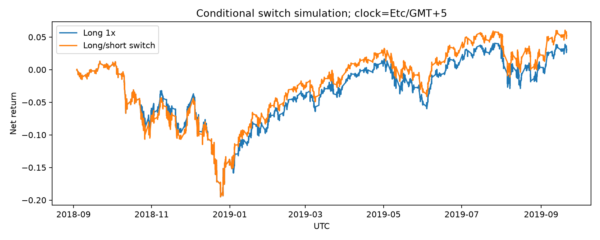

# 트럼프 트윗의 주제와 금융시장 단기 반응

트윗의 발언 주제를 LDA로 추출하고 S&P 500 분봉 자료와 연결해 단기 가격 반응을 탐색한 데이터 분석 프로젝트입니다.

## 연구 질문과 구현

- 발언 주제와 특정 표현에 따라 이후 가격 반응이 달라지는가?
- 이벤트 중복·시간대·관측 간격을 바꾸면 결과가 어떻게 달라지는가?
- 거래비용과 동일한 자본·노출 조건을 반영하면 전략 비교가 어떻게 바뀌는가?

텍스트 전처리, LDA 토픽 비교, 이벤트·수익률 생성, 회귀 분석과 탐색적 백테스트를 연결했습니다. 원래의 분석 노트북과 발표 결과는 보존하고, 후속 검증 코드를 별도 모듈로 구성했습니다.

## 데이터와 성과 해석

저장소의 트윗·분봉 원본과 가공 입력을 사용한 검증 기록을 제공합니다. 기존 업무/포트폴리오 성과와 이번 입력의 데이터셋·기간·전략 조건이 동일한지는 확인되지 않았습니다. 비공개 원자료가 관련된 기존 성과의 직접 재현 검증은 보류하며, 이번 조건부 실험으로 과거 성과를 반증하지 않습니다.

현재 공개 코드의 분석 가정과 결과는 별도로 평가합니다. 가격 시각의 UTC/고정 EST 가정, 실제 경과시간, 이벤트 중복, 거래비용과 표본 외 분할이 결과에 영향을 줍니다. 통계적 연관성을 인과관계나 실거래 수익성으로 해석하지 않습니다.

## 확인한 내용

| 항목 | 실행·검토 범위 |
|---|---|
| 텍스트 모델링 | 원형 LDA 재실행과 학습 구간 전용 토픽 수 비교 |
| 시간 정합성 | 혼합 DST 오프셋 파싱 수정, UTC/고정 EST 민감도 |
| 이벤트·통계 | 실제 경과시간, 비중복 이벤트, 일자 군집 표준오차, BH 보정 |
| 전략 비교 | 진입 지연, 거래비용, 복리 회계, 자본·이벤트 노출 조건 |
| 코드 검증 | 회귀 테스트9개 통과, 원본 데이터 파이프라인 실행 |

검증 구간의 단어 회귀에서는 BH 보정 후 유의한 결과를 확인하지 못했습니다. 비용 가정에 따라 전략 차이의 방향이 바뀌는 경우도 있어 단일 수익률을 대표 성과로 제시하지 않습니다. 상세 조건과 수치는 [검증 보고서](docs/validation.md)에 보존했습니다.



## 구조

```text
src/topic_pipeline.py     전처리·LDA 비교·학습 구간 토픽 점수
src/event_pipeline.py     원본 가격·이벤트·회귀·전략 검증
src/regression.py         기존 회귀 연구 코드
src/backtest.py           기존 이벤트 시각화
notebooks/                원본 탐색 기록
data/                     기존 원본·가공 입력
result/                   기존 발표 자료와 후속 집계 결과
docs/ · tests/            가정·재현 범위·회귀 테스트
```

## 실행

```bash
python -m venv .venv
source .venv/bin/activate
pip install -r requirements.txt
python -m nltk.downloader stopwords
python src/topic_pipeline.py --output result/generated/lda
python src/event_pipeline.py --price-timezone Etc/GMT+5 \
  --topic-input result/generated/lda/train_only_topic_scores.csv \
  --output result/generated/est
```

`Etc/GMT+5`는 UTC-5 고정 EST입니다. `--price-timezone UTC`로 비교 실행할 수 있으며, 가격 공급자의 시간대가 확정됐다는 뜻은 아닙니다.

```bash
pip install -r requirements-dev.txt
pytest -q
ruff check src tests
```

기존 `src/regression.py`가 요구하는 중간 CSV는 현재 저장소에 없어 해당 경로의 완전 재현은 보류입니다. 원본 기반 후속 파이프라인과 구분합니다.

## 한계와 연구 기록

원래 전략 주문 기록·누락된 중간 입력·가격 공급자의 시간대·거래 가능 자산과 비용 근거가 더 필요합니다. 자료 재배포 권한과 독립 미래 기간 검증도 확인 대상입니다. 비공개 자료를 GitHub에 올려야만 이 저장소를 제출할 수 있는 것은 아닙니다.

[상세 검증](docs/validation.md) · [연구 방법](docs/methodology.md) · [이전 README 기록](docs/research-readme-history.md)
